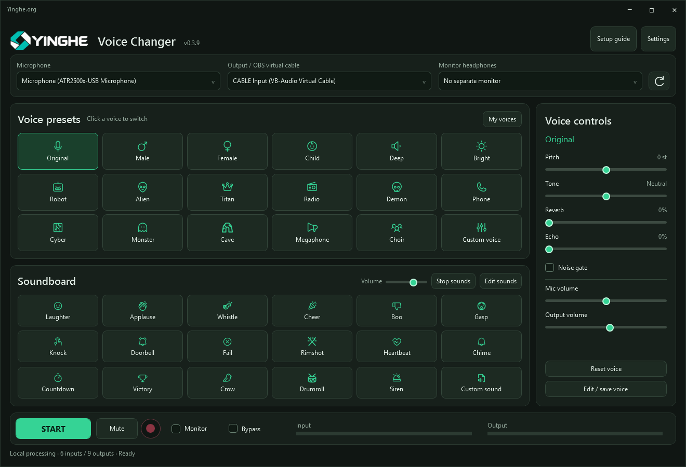

# YINGHE Voice Changer

English · [简体中文](README.zh-CN.md)

**A lightweight voice changer, soundboard and recorder for Windows and Mac.** Switch a preset, shape your sound, add effects and record in **MP3 or WAV** — in one local desktop workspace.

*Windows interface, version 0.3.9. Mac uses its own native interface.*

**[Download on GitHub](https://github.com/jo3sheng/yinghe-voice-changer/releases/latest)** · **[Baidu shared folder](https://pan.baidu.com/s/1pQZ48qI7X-fQc2ppgx84rg?pwd=dp5p)** · Access code: **dp5p**

## One app, plenty to play with

- **Real-time voices:** start with original, male, female, child, deep, bright and robot voices; unlock the remaining characters with Pro.
- **Soundboard:** trigger reaction sounds and effects from the same window. Six sounds are free; Pro unlocks the remaining sounds and editing.
- **Sound controls:** adjust pitch, tone, reverb and echo, with microphone/output volume controls and a noise gate.
- **MP3 and WAV recording:** record the final voice-and-effects mix locally on Windows and Mac, with no recording time limit in Free.
- **Convenient controls:** headphone monitoring, mute, bypass, input/output meters and global shortcuts.
- **Custom presets:** Pro lets you edit and save your own voices for later use.
- **Lightweight local processing:** no large AI voice model download, no per-minute audio-processing charge.
- **OBS and voice chat:** route your processed sound into other apps using a separately installed virtual audio cable.

## Free is useful for everyday work

Free is available for ongoing use. Change your voice, play sounds and make unlimited-length recordings without buying Pro. Upgrade when you want more characters, effects and custom presets.

| Feature | Free | Pro |
| --- | --- | --- |
| Original through Robot: 7 voices | Included | Included |
| First 6 sound effects | Included | Included |
| Basic sound controls | Included | Included |
| MP3 / WAV recording | Unlimited duration | Unlimited duration |
| Remaining built-in voices and effects | — | Included |
| Edit sounds and save custom voice presets | — | Included |
| Price | Free | **US$9.90 once** |
| Subscription | None | None |

**An affordable one-time upgrade:** Pro costs **US$9.90**, with **lifetime free updates, including future major versions**. No monthly bill or annual renewal. One active computer per license. Activate online, then work offline; unbind online before transferring to another computer.

[Buy Pro](https://buy.stripe.com/28EbJ23sW1Bj5XBcbg3AY04) · [Recover a code](https://yinghe.org/voice-changer/account.php) · [Buy me a coffee](https://buy.stripe.com/28E9AU6F85Rz0Dh5MS3AY00)

Coffee is optional support and does not purchase a Pro license.

## 16 interface languages

English, Simplified Chinese, Traditional Chinese, Japanese, Korean, French, German, Italian, Spanish, Russian, Thai, Vietnamese, Arabic, Hebrew, Portuguese and Indonesian.

Choose your language in Settings. Arabic and Hebrew support right-to-left layouts. These are interface languages, not speech synthesis or voice-cloning capabilities.

## Download and install

| Platform | Requirements | Installation |
| --- | --- | --- |
| Windows | .NET 8 Desktop Runtime | Extract the complete ZIP, then run the application. |
| Mac | macOS 13+; Apple Silicon or Intel | Extract the ZIP, move the app to Applications and allow microphone access. |

Select your platform on the [latest release page](https://github.com/jo3sheng/yinghe-voice-changer/releases/latest). The shared Baidu folder uses the same address as YINGHE Studio; select the correct product and platform. `SHA256SUMS.txt` is optional verification material, not an installer.

The current Mac package is ad-hoc signed and is not yet Developer ID signed or notarized by Apple. Its release notes record this packaging status.

## OBS and chat setup

Install the appropriate Windows or Mac version of third-party [VB-CABLE](https://vb-audio.com/Cable/) separately. Select **CABLE Input** as this app's output and **CABLE Output** as the receiving app's microphone. Disable the original microphone feed in the receiving app to avoid doubled sound. Local headphone listening and recording do not require a virtual cable.

## About the “Source code” archives

This repository contains product documentation and screenshots; application installers are attached to Releases. **YINGHE application source code is not published here.** GitHub automatically calls its repository snapshots “Source code”; here those archives contain documentation and assets, not application source. Third-party components retain their own licenses.

[Product website](https://yinghe.org/voice-changer.html) · [Support](mailto:licenses@yinghe.org)
