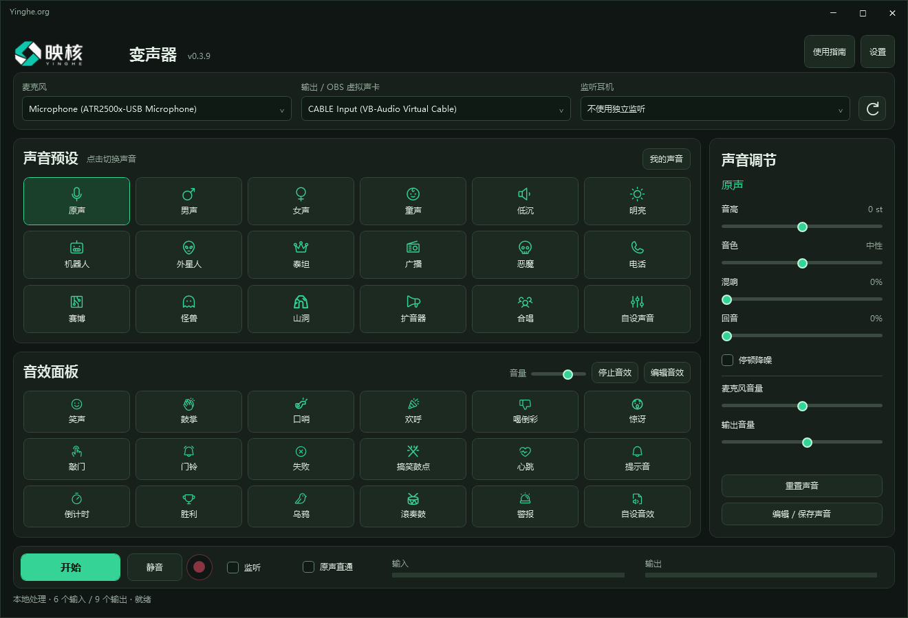

# 映核变声器

[English](README.md) · 简体中文

**轻量、本地处理的变声、音效与录音工作台，支持 Windows 和 Mac。**切换预设、调整声音、加入音效，再录制为 **MP3 或 WAV**，在一个顺手的桌面界面中完成。

*Windows 界面版本为 0.3.9；Mac 使用独立的原生界面。*

**[前往 GitHub 下载](https://github.com/jo3sheng/yinghe-voice-changer/releases/latest)** · **[打开百度共享网盘](https://pan.baidu.com/s/1pQZ48qI7X-fQc2ppgx84rg?pwd=dp5p)** · 提取码：**dp5p**

## 一款软件，多种声音玩法

- **实时变声：**免费体验原声、男声、女声、童声、低沉、明亮、机器人共 7 种声音；专业版解锁其余内置角色。
- **音效面板：**在同一个窗口触发反应音效。免费使用前 6 个音效，专业版解锁更多音效与编辑功能。
- **声音调节：**调整音高、音色、混响、回音，配合麦克风音量、输出音量和噪声门，找到合适的声音效果。
- **MP3／WAV 录音：**Windows 与 Mac 均可在本地录制最终人声与音效混音，免费版也不限录音时长。
- **操作顺手：**支持耳机监听、静音、原声直通、输入输出电平及全局快捷键，减少来回切换窗口。
- **保存自己的声音：**专业版可编辑并保存自定义声音预设，下次直接调用。
- **轻量本地处理：**声音在自己的电脑上处理，不需要下载大型 AI 语音模型，也不按处理分钟收费。
- **连接直播与聊天：**通过另行安装的虚拟音频线，将处理后的声音送入 OBS 或聊天软件。

## 免费版就能满足日常使用

免费版可以长期使用，包含变声、音效、基础调节和不限时录音。先用免费版完成日常聊天、试玩和录音；想要更多声音风格和自定义能力时，再升级专业版。

| 功能 | 免费版 | 专业版 |
| --- | --- | --- |
| 原声至机器人，共 7 种声音 | 包含 | 包含 |
| 前 6 个音效 | 包含 | 包含 |
| 基础声音调节 | 包含 | 包含 |
| MP3 与 WAV 录音 | 不限时长 | 不限时长 |
| 其余内置声音与音效 | — | 全部解锁 |
| 编辑音效、保存自定义声音预设 | — | 包含 |
| 价格 | 免费 | **US$9.90 一次买断** |
| 订阅费用 | 无 | 无 |

**小价格，一次买断，永久免费更新：**专业版仅需 **US$9.90**，一次付款，**永久免费更新，包含未来大版本**。没有月费，不需要按年续费。每个授权同时激活一台电脑；首次联网激活，之后可离线使用。换电脑前先联网解绑，即可转移授权。

[购买专业版](https://yinghe.org/voice-changer/buy.php) · [找回已购买的注册码](https://yinghe.org/voice-changer/account.php) · [请我喝杯咖啡](https://buy.stripe.com/28E9AU6F85Rz0Dh5MS3AY00)

咖啡仅为自愿支持，不购买专业版、不生成专业版注册码。

## 支持 16 种界面语言

简体中文、繁体中文、英语、日语、韩语、法语、德语、意大利语、西班牙语、俄语、泰语、越南语、阿拉伯语、希伯来语、葡萄牙语、印度尼西亚语。

在设置中切换语言。阿拉伯语和希伯来语支持从右向左布局。这里指软件界面语言，不代表语音合成或声音克隆能力。

## 下载与安装

| 系统 | 要求 | 安装方式 |
| --- | --- | --- |
| Windows | .NET 8 桌面运行时 | 完整解压 ZIP 后运行应用。 |
| Mac | macOS 13+，Apple Silicon 或 Intel | 解压后将应用移入“应用程序”，并允许访问麦克风。 |

在 [GitHub 最新发行页](https://github.com/jo3sheng/yinghe-voice-changer/releases/latest) 选择对应系统。百度网盘与映核工作室使用同一地址，进入后按产品和系统选择。`SHA256SUMS.txt` 是可选的文件校验材料，不是安装程序。

当前 Mac 安装包使用 ad-hoc 签名，尚未完成 Apple Developer ID 签名和公证；发行说明也保留了此打包状态。

## 接入 OBS 或聊天软件

请另行安装对应系统的第三方 [VB-CABLE](https://vb-audio.com/Cable/)。本软件输出选择 **CABLE Input**，接收软件的麦克风选择 **CABLE Output**；关闭接收端原麦克风输入，避免双重声音。仅在本机用耳机试听或录音，无需虚拟音频线。

## 关于“Source code”文件

本仓库放置产品说明与软件截图，安装包作为 Release 附件提供。**这里没有公开映核软件的应用源码。**GitHub 会自动把仓库快照标为“Source code”，但这里的快照只包含说明与素材，不是软件源码。第三方组件仍遵循各自许可证。

[产品官网](https://yinghe.org/voice-changer.html) · [联系支持](mailto:licenses@yinghe.org)
